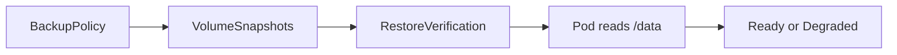

# iris-backup-operator

A Kubernetes operator that snapshots selected PersistentVolumeClaims on a schedule and can restore a snapshot to check that the data is readable.

A VolumeSnapshot only records that the storage driver accepted the request. This operator treats a backup as successful after that snapshot exists, and, when `verifyRestore` is set, after a command has read the restored volume.

## How it works

`BackupPolicy` is the API you apply. The controller lists PersistentVolumeClaims in the policy namespace that match `targetSelector`. When the cron schedule is due, it creates one `VolumeSnapshot` per claim, deletes snapshots beyond `retention` (oldest first), and records `status.lastSuccessfulBackupTime`.

With `verifyRestore: true`, it also creates a `RestoreVerification` for each snapshot. That controller restores the snapshot into a new claim, runs `verification.command` in a pod with the volume mounted read-only at `/data`, and writes the exit code into status. It then deletes the pod and the restored claim. The source claim and the snapshot stay. The policy copies the latest finished result into `status.lastVerification` and sets `Degraded` when the command fails.

Deleting a `BackupPolicy` removes the snapshots it owns, then removes the finalizer `ops.leandro.ie/backup-policy`. The object stays in `Terminating` until the controller is running and those snapshots are gone.



The verification pod runs as UID 65534, with a read-only root filesystem, dropped capabilities, and the `RuntimeDefault` seccomp profile. A `NetworkPolicy` named `iris-backup-verification-deny` in that namespace selects those pods and allows no ingress or egress.

## API

Group: `ops.leandro.ie/v1alpha1`.

### BackupPolicy

| Field | Default | Purpose |
| --- | --- | --- |
| `spec.targetSelector` | required | Label selector for PersistentVolumeClaims in the same namespace. An empty selector is rejected. |
| `spec.schedule` | `0 0 * * *` | Five-field cron expression in UTC. `@daily` and other descriptors are rejected. |
| `spec.retention` | `7` | Snapshots kept per claim. Must be at least 1. |
| `spec.suspend` | `false` | Skips new snapshots. Retention still runs. |
| `spec.snapshotClassName` | cluster default | `VolumeSnapshotClass` to set on created snapshots. |
| `spec.verifyRestore` | `false` | Create a `RestoreVerification` after a successful run. |
| `spec.verification` | | Image, command, and optional `timeoutSeconds` (default 600). Required when `verifyRestore` is true. |

`kubectl get backuppolicies` prints Schedule, Last Backup, and Ready.

`status.conditions` uses `Ready` and `Degraded`. `Ready` is True when the policy is reconciled and the latest run is not failing. `Degraded` is True when the latest backup or verification failed.

### RestoreVerification

The policy controller creates these. You can also apply one yourself.

| Field | Purpose |
| --- | --- |
| `spec.snapshotName` | `VolumeSnapshot` in the same namespace. |
| `spec.persistentVolumeClaimName` | Claim the snapshot was taken from. Its access mode, storage request, and storage class are copied onto the restored claim. |
| `spec.verification` | Image and command run against the restored volume. |

`status.phase` moves `Pending` to `Running`, then to `Succeeded` or `Failed`. `kubectl get restoreverifications` prints Phase and Ready.

Admission: a mutating webhook fills an empty schedule, retention, and suspend. A validating webhook rejects a schedule the controller cannot run, retention below 1, an empty selector, and `verifyRestore: true` without an image and command. Deletion is always allowed.

## Requirements

- Kubernetes with the VolumeSnapshot CRDs, the snapshot controller, and a CSI driver that can create snapshots.
- Go 1.26 to build and run the manager from source.
- For `make deploy`, an image registry and [cert-manager](https://cert-manager.io/) in the cluster. The default install serves the webhooks from a cert-manager certificate.

## Run the controller locally

Point `kubectl` at the cluster, then from this repository:

```sh
make install
go run ./cmd/main.go --webhook-port=-1
```

`make install` applies the CRDs. `--webhook-port=-1` skips the webhook server, which otherwise expects a TLS certificate at `/tmp/k8s-webhook-server/serving-certs/tls.crt`. With that flag, admission webhooks are not called.

`config/samples/ops_v1alpha1_backuppolicy.yaml` is a policy for claims labeled `app.kubernetes.io/name: iris`. It does nothing useful until those claims exist and the cluster can snapshot them.

## Deploy in the cluster

```sh
make docker-build docker-push IMG=<registry>/iris-backup-operator:tag
make deploy IMG=<registry>/iris-backup-operator:tag
```

The manager image is distroless, runs as UID 65532, and pins its base images by digest. See `Dockerfile`.

The Deployment runs in `iris-backup-operator-system`. RBAC for that service account is explained in [docs/rbac.md](docs/rbac.md).

Remove the manager, then the CRDs:

```sh
make undeploy
make uninstall
```

Deleting the CRDs deletes every `BackupPolicy` and `RestoreVerification`.

## Demo

`demo/run-demo.sh` deploys a small database, applies a `BackupPolicy` that verifies each snapshot, corrupts the file so the next check fails, and restores the volume from a snapshot. The cluster needs the hostpath CSI driver and snapshot class used by `demo/01-app.yaml` (`csi-hostpath-sc`). Start the manager before the script, as in the local run above.

## Development

```sh
make test
make manifests generate
```

`make test` regenerates manifests, formats, vets, and runs the unit and envtest suites. End-to-end tests (`make test-e2e`) need a dedicated kind cluster, not a shared one.

## License

Copyright 2026.

Licensed under the Apache License, Version 2.0 (the "License");
you may not use this file except in compliance with the License.
You may obtain a copy of the License at

    http://www.apache.org/licenses/LICENSE-2.0

Unless required by applicable law or agreed to in writing, software
distributed under the License is distributed on an "AS IS" BASIS,
WITHOUT WARRANTIES OR CONDITIONS OF ANY KIND, either express or implied.
See the License for the specific language governing permissions and
limitations under the License.
