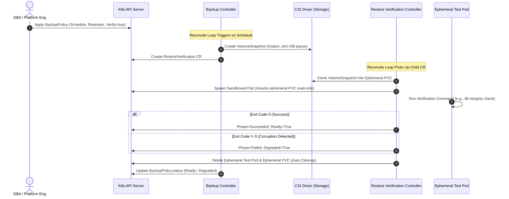

# Live Demo Guide: The Power of Kubernetes & Automated Restore Verification

> **The Big Idea**: Backups are an illusion; restores are reality. This demo proves why Kubernetes and the Operator pattern turn backup testing from a risky, quarterly chore into **continuous, automated verification**.

---

## 1. The Core Narrative: "Schrödinger's Backup"

> *"The condition of any backup is unknown until you try to restore it."*

In traditional enterprise infrastructure:
- Backups are brittle cron jobs executing shell scripts or calling storage APIs.
- They report "Success" simply because a file or snapshot was created.
- Testing restores is done manually once a quarter (or never) because provisioning a test VM, attaching storage, verifying DB consistency, and cleaning up takes hours.
- **The Disaster**: You discover a corrupted table, missing encryption key, or broken filesystem at **3:00 AM on Sunday** during a production outage.

### How Kubernetes Changes the Paradigm

| Traditional Infrastructure | Kubernetes + Operator Pattern |
| :--- | :--- |
| **Imperative Scripts**: `ssh host && tar -czf ...` | **Declarative Intent**: `BackupPolicy` CRD defines *what* must be maintained. |
| **Unverified Snapshots**: "File created" = success. | **Continuous Verification**: Every snapshot is restored into an isolated sandbox and verified. |
| **Manual Cleanup**: Forgotten test disks cause cloud bill spikes. | **Orchestrated Garbage Collection**: Ephemeral pods & claims vanish automatically after verification. |
| **Siloed Alerting**: Disconnected email notifications. | **Kubernetes-Native Health**: Exposed via `.status.conditions` (`Ready`, `Degraded`), Prometheus, & Argo CD. |
| **Vendor Lock-in**: Cloud-specific scripts. | **Portability via CSI**: Identical logic works on AWS EBS, GCP PD, AzureDisk, or on-prem SAN. |

---

## 2. Architecture & Control Flow



---

## 3. Recommended Presentation Setup

To deliver maximum visual impact during a presentation, use 3 terminal panes (e.g. in `tmux`, iTerm2, or VS Code):

- **Pane 1 (Operator Manager Process)**:
  Run the controller manager so it reconciles the cluster:
  ```bash
  # Inside op-dev VM:
  cd /home/ubuntu/iris-backup-operator
  ./bin/manager --webhook-port=-1
  ```
- **Pane 2 (Live Resource Dashboard)**:
  Continuous watch of real-time cluster state:
  ```bash
  watch -n 1 "kubectl get backuppolicies,restoreverifications,volumesnapshots,pvc,pods -n iris-demo"
  ```
- **Pane 3 (Speaker Console)**:
  Run the demo commands or `./demo/run-demo.sh`.

---

## 4. The 4-Act Storyboard & Talking Points

### Act 1: The Stateful Workload (Setting the Stage)
- **Action**: Deploy the stateful application with its persistent storage:
  ```bash
  kubectl apply -f demo/01-app.yaml
  ```
- **Talking Point**:
  > *"Kubernetes handles stateless apps with ease, but real business value lives in stateful data. Here is our database actively committing financial transactions to a Persistent Volume Claim."*

### Act 2: Declarative Automation (The "Happy Path")
- **Action**: Apply the backup policy:
  ```bash
  kubectl apply -f demo/02-backuppolicy.yaml
  ```
- **What the Audience Sees**:
  1. A CSI snapshot is created instantly.
  2. The operator immediately spawns an ephemeral test PVC from that snapshot.
  3. A disposable container mounts the test PVC read-only, verifies the database checksum, and exits `0`.
  4. The test pod and test claim disappear automatically.
  5. `kubectl get backuppolicies` transitions to `Ready=True`.
- **Talking Point**:
  > *"We didn't run an imperative script. We simply declared: 'Keep 3 snapshots, and prove each one works.' Kubernetes orchestrated the sandbox, validated integrity, cleaned up all resources, and updated cluster status—automatically."*

### Act 3: Catching Silent Corruption (The "Aha!" Moment)
- **Action**: Simulate silent data corruption in the running database:
  ```bash
  POD=$(kubectl get pods -n iris-demo -l app=demo-database -o jsonpath='{.items[0].metadata.name}')
  kubectl exec -n iris-demo $POD -- /bin/sh -c 'echo "CHECKSUM: CORRUPT_BAD_DATA" > /data/db.dat'
  ```
- **What the Audience Sees**:
  1. The next scheduled backup triggers.
  2. The operator restores the snapshot to a sandbox pod and runs the verification.
  3. The verification fails (exit code 1).
  4. The operator flags `RestoreVerification` as `Failed` and `BackupPolicy` as `Degraded=True`.
  5. A Kubernetes Warning Event is emitted.
- **The Punchline**:
  > *"In traditional IT, you discover corrupt data during disaster recovery at 3 AM on Sunday. With this operator, you discover it at 2 PM on Tuesday during routine validation—without touching production data."*

### Act 4: Phoenix Recovery (Zero-to-Restored in 30 Seconds)
- **Action**: Simulate a catastrophic operational disaster (accidental deletion):
  ```bash
  kubectl delete deployment iris-db -n iris-demo
  kubectl delete pvc iris-data -n iris-demo
  ```
- **Action**: Restore from the latest verified snapshot:
  ```bash
  SNAP=$(kubectl get volumesnapshots -n iris-demo -o jsonpath='{.items[0].metadata.name}')
  sed "s/LATEST_VERIFIED_SNAPSHOT/${SNAP}/g" demo/03-restore-disaster-recovery.yaml | kubectl apply -f -
  ```
- **Talking Point**:
  > *"Because our snapshots were continuously pre-verified, recovery isn't a hope—it's a certainty. Within 15 seconds, our application is restored and serving traffic with zero data loss."*

---

## 5. Teardown
```bash
./demo/cleanup.sh
```
